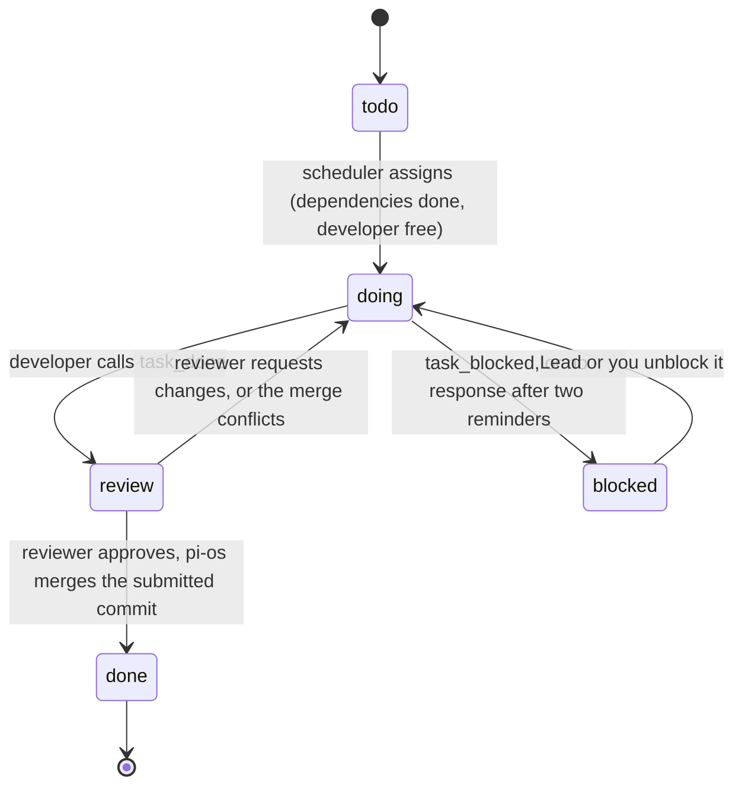
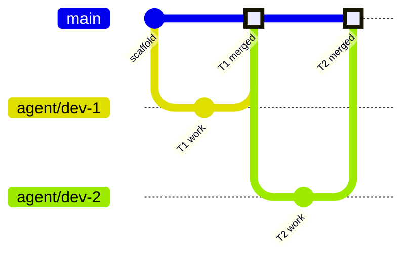

# The pi-os software development lifecycle

How a pi-os project turns a goal into working software, who does what, and how this compares with the methodologies human teams use.

This document describes the process as implemented today (milestones M1 to M5, see [design/agent-teams.md](design/agent-teams.md)). Where a rule lives only in an agent's prompt instead of in code, the tables say so: a prompt is guidance a model can ignore, code is a guarantee.

## 1. In one paragraph

You state a goal. A team of AI agents writes the requirements, the design and a backlog, and stops twice for your approval: once after the requirements, once after the backlog. After the second approval, pi-os itself (plain code, not a model) runs the build. It hands each developer agent one ready task at a time, sends finished work to a reviewer agent, and merges what the reviewer approves into `main`. The App tab runs the product from `main` and restarts it after each merge. You watch every agent live, can message any of them, and can edit the board, pause the build or stop everyone at any moment. You decide what gets built and whether it's acceptable; the agents do the work; code does the bookkeeping.

## 2. Principles

1. **You lead.** You own the goal, approve scope at the gates, and can override any agent or item. Agents propose; you decide.
2. **Agents do the work, code coordinates.** Models write documents, plans, code and reviews. Assignment, routing, merging and restarts run as deterministic code, so they cost no tokens and behave the same every time.
3. **Every decision lands in a file.** Agents forget between conversations and can't overhear each other. Requirements, design, decision records and wireframes live in the repository, and briefs point at them.
4. **Isolation by default.** Each agent works in its own git worktree on its own branch. Agents can't overwrite each other's files, and work reaches `main` only through a merge.
5. **Review the exact thing you merge.** The reviewer tests the commit the developer submitted, and pi-os merges that commit, not whatever the branch holds later.
6. **Everything is visible while it happens.** Tiles show what each agent is doing, the board shows every task's state, and the activity feed records each step.
7. **Runs survive restarts.** Agents are durable conversations, and the build's state lives in stored documents. A crash or restart resumes the work instead of losing it.

## 3. The lifecycle

```mermaid
flowchart LR
    G([Your goal + attachments]) --> K[Kickoff<br/>Lead forms the team]
    K --> D[Discovery<br/>Product Owner writes requirements]
    D --> G1{Gate 1<br/>You approve<br/>the requirements}
    G1 -- changes --> D
    G1 -- approved --> S[Design<br/>Architect, UX Designer]
    S --> P[Planning<br/>Planner builds the backlog]
    P --> G2{Gate 2<br/>You approve<br/>the backlog}
    G2 -- changes --> P
    G2 -- approved --> B[Build<br/>pi-os scheduler: develop, review, merge]
    B --> A[Live preview<br/>App tab runs main]
    A --> F[Feedback on the app<br/>FB-n, tied to the version]
    F --> P2[Planner drafts items<br/>pending]
    P2 --> G3{You approve<br/>pending items}
    G3 -- approved --> B
```

| Stage | Led by | Input | Output | Exit | Enforced by |
|---|---|---|---|---|---|
| Kickoff | Lead | Your goal, attachments | A team sized for the goal; questions to you if the goal is too vague | Team formed, product owner briefed | Prompt |
| Discovery | Product Owner | Goal, attachments | `docs/requirements.md` with acceptance criteria, assumptions, open questions; first decision records | **Gate 1:** you approve the requirements (the Lead asks you on the Overview tab) | Prompt (the Lead must wait for your answer) |
| Design | Architect, UX Designer | Approved requirements | `docs/design.md`, decision records, wireframes, `.pios/project.json`, an app skeleton | Design published and reported to the Lead | Prompt |
| Planning | Planner | Requirements, design | Backlog: features, PBIs with acceptance criteria, tasks with dependencies, estimate and area | **Gate 2:** you approve the backlog on the Backlog tab, or send it back with a comment | **Code:** the scheduler assigns nothing until the backlog is approved |
| Build | pi-os scheduler | Approved backlog | Reviewed, merged tasks on `main`; a running preview | All tasks done; pi-os tells the Lead | **Code** |
| Iterate | You, Planner | The running app | Feedback (FB-n) → pending PBIs and tasks | **Gate 3:** you approve the pending items (Backlog tab) | **Code:** pending items are never assigned |

**Readiness.** Every approval to build (the backlog, and pending items later) is refused by the server while a **blocking question** is open. The Overview tab shows whether the project is ready.

The stage label in the project header follows the Lead's `set_stage` calls, except **build**, which pi-os sets itself when the backlog is approved.

## 4. Roles

| Role | Who | Responsible for | Can't |
|---|---|---|---|
| **Human lead** | You | The goal, gates 1 and 2, priorities, final acceptance; steering anyone at any time | (no limits) |
| **Lead** | Agent | Forming the team, briefing, sequencing stages, unblocking, talking to you | Write product code (it works in `main` and has no `publish`) |
| **Product Owner** | Agent | `docs/requirements.md`: stories, scope, non-goals, testable acceptance criteria | |
| **Architect** | Agent | `docs/design.md`, decision records, wireframes, `.pios/project.json`, the skeleton in `app/` | |
| **UX Designer** | Agent, optional | Flows, wireframes, visual style | |
| **Planner** | Agent | The backlog, through the backlog tools | Edit `docs/backlog.md` (pi-os writes it) |
| **Developer** | Agent, one or more | One task at a time in `app/`, tests, `task_done` or `task_blocked` | Publish task work directly; mark its own task review or done |
| **Reviewer** | Agent, optional | Testing the submitted commit against the task, its acceptance criteria, the design and the layout; `review_verdict` | Edit the code under review |
| **Scheduler** | pi-os code | Assignment, review routing, merging, reminders, roll-up, preview restarts | Make judgement calls (it escalates to the Lead) |

The Lead chooses roles and headcount per goal and can add any role it needs. A role pi-os doesn't know gets a generic specialist prompt. Every agent can run on a different model; you switch models per project or per agent.

## 5. Artifacts

| Artifact | Where | Owner | Source of truth |
|---|---|---|---|
| Goal | Project record | You | pi-os |
| Attachments (specs, mockups, data) | `<project>/attachments/`, outside git | You | That folder; agents read them in place and cite them |
| Requirements | `docs/requirements.md` | Product Owner | Repository |
| Design | `docs/design.md` | Architect | Repository |
| Decision records | `docs/decisions/NNNN-<slug>.md` | Whoever made the decision | Repository; accepted records are superseded, never rewritten |
| Wireframes | `docs/wireframes/<screen>.html` | Architect or UX Designer | Repository |
| Prototypes | `docs/prototypes/<name>/` | Anyone proving a risky choice | Repository; `app/` never imports from it |
| Backlog | Backlog tab | Planner, you | **pi-os**; `docs/backlog.md` is a regenerated snapshot |
| Run configuration | `.pios/project.json` | Architect | Repository |
| The product | `app/` | Developers | `main` branch |
| Activity, questions, transcripts | Project page | (generated) | pi-os |

The repository layout is fixed: `app/` holds everything the product needs to build and run and nothing else, `docs/` holds everything else, and agents may not add top-level folders.

## 6. Work items

### Hierarchy

**Feature → PBI (product backlog item, with acceptance criteria) → Task.** A task is one developer's work for one sitting. It carries dependencies, an S/M/L estimate and an *area*: the part of `app/` it touches. A PBI's and a feature's status follow their children: done when all children are, in progress when any has started.

### Task lifecycle

### Rules the scheduler applies

- **Ready** means status *todo*, not pending approval, with every dependency *done*.
- **Pending** items wait for you: anything drafted from feedback, and anything an agent adds after you approved the backlog. pi-os assigns none of them until you approve them on the Backlog tab. A dependency on a PBI or feature waits for all of it.
- **One task per developer.** A developer holding a task in *doing*, *review* or *blocked* gets no new work. The task stays theirs through review, so review notes go back to the person who wrote the code.
- **Areas spread the work.** Among ready tasks, a developer gets one whose area nobody else is working in, to keep parallel edits from colliding.
- **Pinned tasks wait for their person.** A task you or the Lead assigned to a developer waits for that developer.
- **Briefs carry context.** pi-os syncs the developer's worktree with `main`, then sends the task, its PBI, the PBI's acceptance criteria, what it builds on, and earlier review notes.
- **Reminders, then escalation.** If an agent ends its turn holding a task (no `task_done`, no question waiting for you), pi-os reminds it. After two reminders the task becomes *blocked* and the Lead gets the reason.
- **Review is optional.** With no reviewer on the team, submitted work merges at once. The Lead prompt asks for a reviewer.
- **Pause** stops new assignments; work in progress continues.

## 7. Branching and integration

- Each agent gets a worktree at `<project>/worktrees/<key>` on branch `agent/<key>`. The Lead works in `main` itself and doesn't publish.
- **Task work** goes through `task_done`. pi-os commits the worktree and merges the latest `main` into the branch. A conflict goes back to the developer to resolve. The resulting commit is what the reviewer gets, checked out detached in the reviewer's worktree, and what pi-os merges (`--no-ff`) once it's approved. If `main` moved and the merge now conflicts, the task returns to the developer.
- **Non-task work** (requirements, design, decision records, the skeleton) goes through `publish`: commit, merge `main` in, merge into `main`. It skips review today.
- `main`'s first-parent history reads as one entry per task or publish, which the Repo tab shows.
- Merges that touch `app/` or `.pios/` restart the preview a few seconds later, from a separate checkout of `main`.

## 8. Quality controls

| Control | How | Strength |
|---|---|---|
| Testable requirements | The Product Owner writes acceptance criteria; the Planner copies them onto PBIs; briefs and reviews quote them | Prompt |
| Recorded decisions | Decision records for every significant choice, in a fixed format | Prompt |
| Repository layout | Fixed layout in every agent's instructions; reviewers check it | Prompt |
| Isolation | Worktree per agent; file tools refuse writes outside it | **Code** (the shell is not confined) |
| Review before merge | Detached checkout of the submitted commit; approve or send back | **Code** routes it; the verdict is the reviewer's judgement |
| Tests | Developers write and run them; reviewers run them | Prompt |
| Running product | The preview runs `main` after each merge; agents read its status and logs with the `preview` tool | **Code** |
| Human acceptance | Gates 1 and 2; the App tab | You |

Missing today: a definition-of-done checklist, automatic test runs as a merge condition, traceability from each requirement to its tests, and review of non-task publishes.

## 9. Where you take control

- **Gates:** approve or send back the requirements (Overview tab), the backlog, and pending items (Backlog tab). Blocking questions hold all of them.
- **Questions:** answer, dismiss, or switch between blocking and non-blocking.
- **Feedback:** on the App tab; make a PBI from it yourself, decline it, or reopen it.
- **Talk to anyone:** open a tile and message the agent. Your message interrupts its current step (steer), and answers any question it asked you.
- **Edit the plan:** drag cards, change status, assignee, estimate, title, description and acceptance criteria, or delete items.
- **Control the build:** Pause / Resume on the Backlog tab, Stop all in the header.
- **Choose models:** for the project, for new agents, or per agent.
- **Add material:** attach files when you create the project, when you answer a question, or in any agent's drawer.
- **Run the product:** start, stop or restart the preview, open it in a tab, read its logs.

## 10. How agents communicate

- **Briefs** from the Lead or from pi-os start work. They must hold everything the agent needs, because agents can't see each other's conversations.
- **Messages** (`message`) reach one teammate by key and queue behind its current step. The team guide forbids acknowledgements and chit-chat: every message wakes the receiver and costs tokens.
- **Questions to you** (`ask_user`) appear on the agent's tile and the Overview tab. A **blocking** question (the default) ends the agent's turn; it resumes when you answer or dismiss it, and no approval to build goes through meanwhile. A **non-blocking** question carries the assumption the agent works with, and the agent keeps going. You can switch a question between the two, answer it, or dismiss it.
- **Feedback** on the running app (App tab → Feedback) goes to the Planner (or the Lead without one) as FB-n, with the version of `main` you were looking at. The Planner drafts PBIs and tasks tagged with it; you can also make a PBI yourself, or decline the feedback.
- **Handoffs** (`task_done`, `task_blocked`, `review_verdict`, `backlog_request_approval`) are tools, not messages, so pi-os can act on them.

## 11. Resilience

- Agents are durable pi-durable conversations: a restart resumes every agent where it stopped.
- The scheduler keeps all state in the backlog document and marks each brief as sent only after delivery. On restart it re-sends exactly the briefs that never went out.
- The preview records its dev server's processes, kills them on stop and restart, and removes leftovers from a crashed pi-os on the next start.

## 12. Compared with human-oriented methodologies

### Side by side

| Dimension | Waterfall / V-model | Scrum | Kanban | pi-os (agentic, human-led) |
|---|---|---|---|---|
| Planning horizon | Whole project up front | One sprint, refined continuously | Continuous, just in time | Whole goal up front (requirements → design → backlog), then continuous flow |
| Cadence | Phases with sign-offs | Fixed sprints (1–4 weeks) | None; flow | None; flow. A small app goes from goal to running in minutes |
| Who decides scope | Customer signs the spec | Product Owner, sprint by sprint | Whoever orders the queue | You, at two gates, plus edits at any time |
| Who coordinates | Project manager, plan | Self-organising team, Scrum Master | Team, WIP limits | Lead agent for the pre-build stages; deterministic code for the build |
| Work assignment | Manager assigns | Team members pull in the sprint | Team members pull | The scheduler pushes the next ready task to a free developer |
| WIP control | None explicit | Sprint scope | Explicit WIP limits per column | One task per developer, enforced in code |
| Communication | Documents | Daily stand-up, conversation | Board, conversation | Files in the repo, briefs, targeted messages; no shared memory |
| Documentation | Heavy, contractual | "Just enough" | Light | Mandatory and structured: it's the agents' only shared memory |
| Status visibility | Reports, milestones | Sprint board, burndown | Board, cumulative flow | Live tiles, live board, activity feed, transcripts |
| Review | Phase reviews, inspections | Pull requests, sprint review | Pull requests | Review agent on every task's exact commit; you at the gates |
| Integration | Late, big-bang | Continuous, per story | Continuous | Per task, with `main` merged in before review |
| Feedback | At the end | Every sprint review | Continuous | Continuous: feedback on the live app becomes pending backlog items you approve |
| Change handling | Change requests | Next sprint | Reorder the queue | Edit the board, pause, message any agent, re-gate |
| Scarce resource | People's time | People's time | People's time | **Your attention** and tokens; agent time is cheap |
| Typical failures | Wrong spec found late | Scope churn, unfinished stories | Starved or blocked flow | Agents stall, drift from the spec, or misread a vague brief |

### What changes when the workers are agents

**Time costs almost nothing; attention costs the most.** A developer agent finishes a small task in a minute or two, so the bottleneck moves to you: reading requirements, approving the backlog, judging the result. pi-os puts your effort at two gates and the live preview instead of daily ceremonies.

**Agents need explicit context.** People pick up context in hallways and meetings, and they remember last week. Agents start each conversation knowing only their instructions, their brief and the files they read. That is why this process insists on written requirements, decision records, a fixed repository layout and self-contained briefs, and why it forbids side-channel chat. In a human team that much documentation would be overhead; here it's the coordination mechanism.

**Ceremonies become code or views.**

| Scrum element | Purpose | pi-os equivalent |
|---|---|---|
| Sprint planning | Choose and size the next work | Planner builds the backlog; you approve it at Gate 2 |
| Daily stand-up | Who's doing what, who's blocked | Live tiles, the board, `team_list`, blocked tasks escalated to the Lead |
| Scrum Master | Remove impediments, guard the process | The scheduler (reminders, escalation, routing) and the Lead (unblocking) |
| Sprint backlog / board | Make work visible | The Backlog tab, live |
| Definition of done | Shared quality bar | Partly: review against acceptance criteria. No checklist yet |
| Sprint review | Inspect the increment with stakeholders | The App tab, at any time |
| Retrospective | Improve the process | Missing (M6) |
| Velocity, burndown | Forecasting | Build progress bar and counts; no forecasting |

**Coordination should be deterministic.** In a human team people negotiate who takes what. Letting a model do that wastes tokens and fails in odd ways (forgotten tasks, double assignment). pi-os uses models for judgement (what to build, how, whether it's good) and code for logistics (who's free, what's ready, what to merge).

**Agents fail differently.** People rarely abandon a task mid-sentence. Agents do: they end a turn without reporting, misread a brief, or confidently build the wrong thing. The process answers with reminders and escalation, review of the exact submitted commit, gates before the expensive stages, and a human who can see and interrupt everything.

**Parallelism is cheap but collisions aren't.** Adding a developer agent costs one more conversation, so the Lead sizes the team to the backlog's parallelism. Worktrees, area-aware assignment and merge-before-review keep parallel work from stepping on itself.

**Accountability stays with you.** Agents sign nothing. The gates exist so a person approves the scope and the plan before agents spend effort building them, and the preview lets you judge the result.

### Compared with AI-assisted methods (BMAD)

BMAD's Method (v6/v7) is the closest relative: specialist agents (analyst, product manager, architect, UX, product owner, developer, test architect), document-first planning (brief, PRD, architecture, UX spec), and stories that carry the context a developer needs. Two differences matter:

- **Who drives.** In BMAD you invoke each agent or workflow in your coding tool and carry the output to the next step; BMad Loop automates an epic. In pi-os the Lead and the scheduler move the work between agents, and you step in at the gates or whenever you choose.
- **What BMAD has that pi-os lacks:** planning sized to the change (a small change skips straight to building), story files that hold all the context a developer needs, a test architect with risk assessment, traceability and quality gates, validation checklists, course correction and retrospectives. These are the main candidates for borrowing (section 13).

## 13. Known gaps

| Gap | Effect today | Direction |
|---|---|---|
| Gate 1 is a question, not a button | The Lead could skip it; it relies on the prompt (blocking questions now hold every approval to build) | Approve / request-changes buttons for requirements and design (M2) |
| Every goal runs every stage | A small change still gets requirements, design and a backlog | Size the process to the goal |
| Thin task briefs | Developers re-read the docs; may drift from the design | Story-style briefs with the relevant design and decisions inlined |
| No definition of done, tests aren't a merge condition | Quality depends on the reviewer | DoD checklist; run `.pios/project.json` `test` before merging |
| No requirement-to-test traceability | Gaps in coverage go unnoticed | Link acceptance criteria to tests in review |
| Non-task publishes skip review | Design and skeleton changes land unreviewed | Route them through review too |
| No retrospective | The team doesn't learn from a build | A retro after the build (M6) |
| The shell is not sandboxed | Agents run commands on your machine | Containers per project (out of scope so far) |
| No cost budget | A large team can spend many tokens | Per-project token budgets and alerts |

## 14. Glossary

- **Gate:** a point where work stops until you approve.
- **PBI:** product backlog item; a user-visible piece of a feature, with acceptance criteria.
- **Area:** the part of `app/` a task touches; used to keep parallel tasks apart.
- **Worktree:** a separate checkout of the repository on the agent's own branch.
- **Submitted commit:** the commit `task_done` produces; reviewed and merged as is.
- **Steer:** a message that reaches an agent before its next step instead of after its turn.
- **Preview:** the product running from `main`, shown in the App tab.
